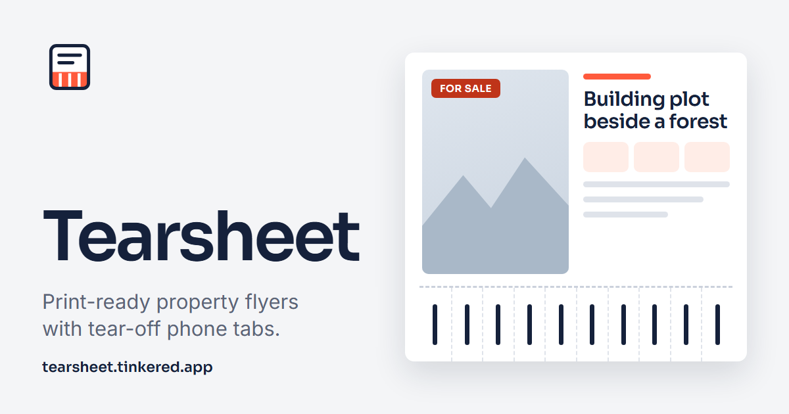

  

<h1 align="center">Tearsheet</h1>

  <b>A property flyer with tear-off phone tabs, on one A4 sheet.</b> 
  Fill in the listing, drop a pin on the map, print.

  <a href="https://tearsheet.tinkered.app/"><b>▶ Make a flyer</b></a>
  &nbsp;·&nbsp; English and Polish
  &nbsp;·&nbsp; installs as an app
  &nbsp;·&nbsp; opens offline
  &nbsp;·&nbsp; no account

---

Tearsheet builds a real-estate flyer on one landscape A4 sheet: a photo, a
map pin, the key facts, an optional QR code, and 20 tear-off phone tabs along
the bottom edge. It works in English and Polish, installs as a PWA, and opens
offline once loaded. The map and the place search need a connection. Offline,
the map picker says so, and the flyer prints without a map: the photo takes
its space.

On Firefox for Android, the app downloads a landscape A4 PDF directly because
its system print dialog scales the flyer down. Other browsers use printing.

Live at <https://tearsheet.tinkered.app>

## Making a flyer

1. Fill in the listing: title, location, area, purpose, utilities, a description
   and a phone number. The area converts between m², ares, hectares, ft² and
   acres when you change the unit.
2. Add a photograph (JPG, PNG or WebP, up to 15 MB), then drag and zoom it to
   frame the crop.
3. Search for the place, then click the map or drag the marker.
4. Optional: a badge, one or two words above the number on each tab, and a link
   that becomes a QR code, generated in the browser.
5. **Review and print**. The preview is the printed sheet, and the app lists
   what is still missing or does not fit before it lets you print. In the print
   dialog choose A4, landscape, no margins, with background graphics on.

## Data

The app stores nothing on a server. Cloudflare, the host, keeps request records
with IP addresses for up to 7 days. Text fields stay in this tab's sessionStorage
through a refresh and are cleared when the page is opened anew. The photo stays
in memory and is lost on refresh. Theme, language and unit choices stay in
localStorage after you use their controls. The service worker caches the app's
own files.

Two OpenStreetMap services receive requests: the tile server draws the map, and
Nominatim answers place searches, only when you press Search. The
[privacy notice](https://tearsheet.tinkered.app/privacy) lists what each recipient gets.

## Restore

The app holds no user data, so restoring it means deploying the code again:
check out the repository and run the deploy command from [AGENTS.md](AGENTS.md),
which also has the commands, conventions and file layout.

## Credits

- [Leaflet](https://leafletjs.com), BSD-2-Clause
- [QR Code Generator](https://github.com/kazuhikoarase/qrcode-generator) by Kazuhiko Arase, MIT
- [html2canvas](https://html2canvas.hertzen.com/), MIT
- [pdf-lib](https://pdf-lib.js.org/), MIT
- Inter and Sora fonts, SIL Open Font License 1.1
- Map data © [OpenStreetMap contributors](https://www.openstreetmap.org/copyright)

The licence texts ship in `public/vendor/`, and
[NOTICE.md](public/vendor/NOTICE.md) there records the version and source of
each library.

Made by Kuba (kuba@tinkered.app).
